# OgOs brand guide

This guide is how OgOs looks, and why. It covers the idea and where it comes from, the base identity, the color, the type, the motifs, and the themes built on them. It ends with how to make something new, a checklist for judging it, and the questions still open.

It's written for anyone making something for OgOs, people and agents alike. [README.md](README.md) explains how to use the kit's files and tools, and how to change this guide. [FEEDBACK.md](FEEDBACK.md) records the operator feedback behind every rule here; when a rule seems arbitrary, the reason is there.

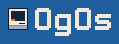

## The idea

OgOs is a 32-bit hobby operating system for x86, the RetrOS-32 project under a new name. Its identity is **the computer it runs on**: the monitor from the RetrOS logo, sitting on the blue of a 90s desktop, with **the light coming up in the bottom-left corner**.

That light starts as the monitor's power LED. Given room, it grows into a striped sun rising from the corner, so a computer coming on reads as a sunrise. The identity is warm, made by hand, and a little nostalgic. It's never a parody of an old OS, and never a copy of one.

## Where it comes from

- **The RetrOS logo:** a cream monitor with a dark screen and a bright LED. OgOs keeps the frame, moves the LED to the bottom left, and stops spelling the name on the screen.
- **90s desktops:** the blue a fresh desktop shows; 32 × 32 beveled icons; BeOS's bright isometric pixel icons.
- **Mission patches:** embroidered, flat colored, set in wide geometric capitals.
- **The early web:** 88 × 31 buttons, linked from page footers.
- **80s computer livery:** stripes that break into squares as they trail off.
- **The OS itself:** RetrOS System, one of the faces, is the kernel's own 8 × 8 font (`lib/font8.c`).

The explorations these came from are in [`../design-explorations/`](../design-explorations/), 110 directions over two rounds. 101 to 110 are the ones this guide grew from.

## The base

The base identity is **the mark on Desktop Blue**. Everything else is a variation on it. When there's no reason to do something else, use the base.

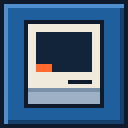

### The mark

The mark is the monitor, front on, drawn as pixel art.

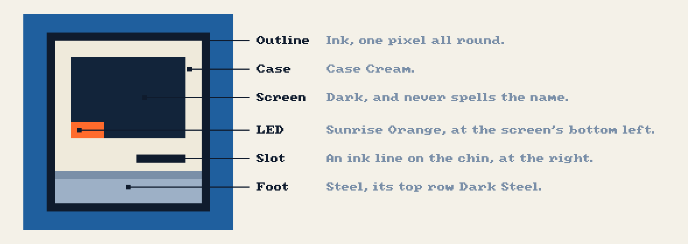

- **The LED is always at the bottom left of the screen.** In the old RetrOS logo it was at the top left; OgOs moved it down, and the sun rises from the same corner.
- **The screen is dark and empty.** It never spells the name, or part of it. The only things that appear on it are the LED, the sunrise, and in themes a scene (a sky, a planet).
- **It's drawn, not scaled down:** each size has a pixel master, made for that size.

| Master | Size | Use |
|---|---|---|
| `tile(32)`, [app-icon](assets/mark/app-icon.svg) | 32 × 32 | The app icon: the monitor on a beveled blue tile with an ink edge. Scale it by whole numbers: 64, 128 ... 1024. |
| `tile(16)`, [app-icon-small](assets/mark/app-icon-small.svg) | 16 × 16 | Favicons and 16-pixel spots. No edge or bevels, so the monitor stays big. |
| `lockupMonitor()`, [monitor](assets/mark/monitor.svg) | 20 × 22 | The monitor alone, for lockups and layouts. |
| `computer()`, [computer-sun](assets/mark/computer-sun.svg), [computer-led](assets/mark/computer-led.svg) | 32 × 32 | The desktop icon: beveled plastic, pixel shading, and the sunrise or the LED on the screen. |
| The badge's monitor | 19 × 21 | Inside the 88 × 31 badge. |

### The wordmark

The name is **OgOs**, set in OgOs Display: two-pixel strokes, with the corners cut by one pixel. It comes from the RetrOS logo's screen lettering.

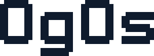

- **Capitalization:** OgOs, a capital O at each end and a small g and s. Wherever the name is set in a pixel face, write it that way. The Mission Patch theme uses OGOS, in Jost capitals. OgOs Micro has only capitals, so its small print says OGOS too.
- **Color:** cream on Desktop Blue or ink; ink on paper and cream. For busy grounds, use cream with a one-pixel ink shadow: `wordmark-shadow`.

### Lockups

The mark and the name together. Each lockup sits on one pixel grid: the monitor, the name and the space between them are whole numbers of one pixel size.

| Lockup | Use |
|---|---|
| **Horizontal**, the primary ([on blue](assets/lockup/horizontal-on-blue.svg), [cream](assets/lockup/horizontal-cream.svg), [ink](assets/lockup/horizontal-ink.svg)) | Headers, title slides, the top of a page. The name is at twice the monitor's pixel size, so its capitals stand exactly as tall as the monitor. |
| **Stacked** ([cream](assets/lockup/stacked-cream.svg), [ink](assets/lockup/stacked-ink.svg)) | Square and tall spaces. |
| **Sunrise screen** ([svg](assets/lockup/sunrise-screen.svg)) | The hero lockup: a tall monitor whose whole screen is the sunrise, with the name once on the chin in OgOs Label. Splash screens, covers, stickers. |
| **Widescreen** ([svg](assets/lockup/widescreen.svg)) | Wide, short spaces like banners. The monitor stretches so the name fits on the screen. This is the one place the screen carries the name, and then nothing else says it. |
| **Desktop icon** ([svg](assets/lockup/desktop-icon.svg)) | The computer labeled as a desktop labels it, in RetrOS System. Only on Desktop Blue, and with no pointer or selection box. |

**The name appears once.** No lockup puts it on the screen and below it as well.

**Clear space:** keep at least a quarter of the monitor's height clear on every side.

**Minimum sizes:**
- The horizontal lockup at 1 output pixel per pixel, 103 × 28.
- The app icon at 32 px; use `app-icon-small` at 16 to 31.
- The wordmark 14 px tall.
- The round patch 200 px across; below that, use `round-patch-icon`.

## Color

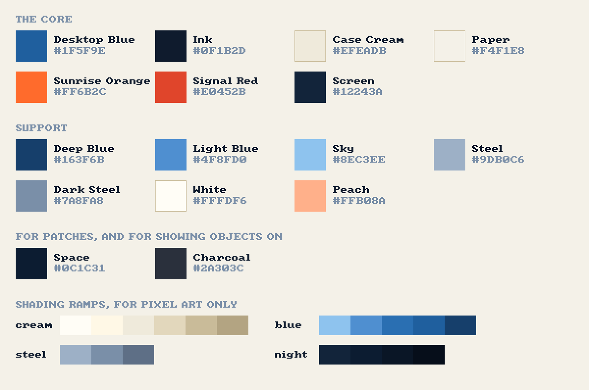

**The core colors:**

| Color | Hex | Role |
|---|---|---|
| Desktop Blue | `#1F5F9E` | The ground. Most of any piece. |
| Ink | `#0F1B2D` | Outlines; text on light grounds. |
| Case Cream | `#EFEADB` | The machine; text on blue. |
| Paper | `#F4F1E8` | The light ground. |
| Sunrise Orange | `#FF6B2C` | The LED; the sun's upper bands. |
| Signal Red | `#E0452B` | The sun's lower bands; small print on cream. |
| Screen | `#12243A` | A screen that's off. |

**Support colors:** Deep Blue and Light Blue (bevels and shadows on blue), Sky (secondary text on blue, a stripe), Steel and Dark Steel (the foot, quiet captions), White, Peach (the LED's glint), Space (a patch's sky) and Charcoal (a ground to show objects like patches on). **Shading ramps** extend these for bevels and isometric faces in pixel art, and nothing else.

**Proportions:**
- Desktop Blue (or Paper, on light pieces) covers most of the area.
- Cream and ink carry the machine and the type.
- Orange and red are the light. They cover a small share of a piece, they sit where the light is (the LED, the sun, a planet at the lower left, a badge's stripes), and they're never a ground.

**Contrast, for text:**

| Text on ground | Ratio | Use |
|---|---|---|
| Cream on Desktop Blue | 5.5:1 | Any size. |
| White on Desktop Blue | 6.5:1 | Any size. |
| Sky on Desktop Blue | 3.5:1 | Large text only. |
| Ink on Paper or Cream | 15:1 | Any size. |
| Signal Red on Cream | 3.5:1 | Bold small print, like a badge's line. |
| Dark Steel on Paper | 2.9:1 | Captions that can be missed. |
| Orange on Desktop Blue | 2.3:1 | Never text. |
| Red on Desktop Blue | 1.6:1 | Never text. |

`tools/check.mjs` flags any color that isn't in the palette or a ramp.

## Type

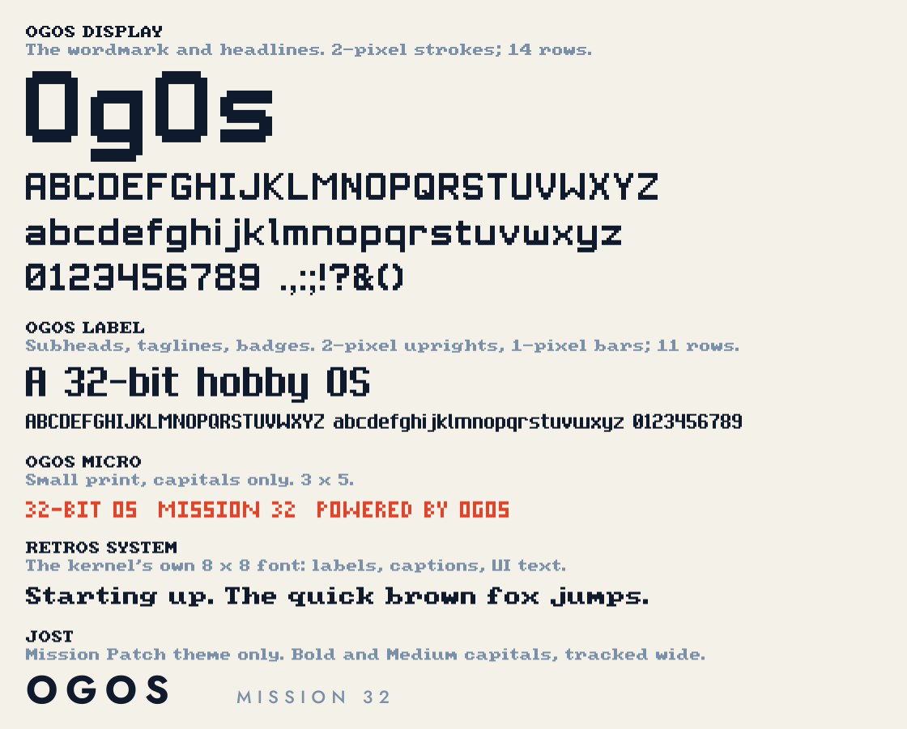

| Face | Grid | For |
|---|---|---|
| **OgOs Display** | 14 rows, caps 11 | The wordmark, headlines. |
| **OgOs Label** | 11 rows, caps 9 | Taglines, subheads, the badge's name, the sunrise screen's chin. |
| **OgOs Micro** | 3 × 5, capitals | Small print: a badge's line. |
| **RetrOS System** | 8 × 8 | Labels, captions, interface text, the desktop icon's name: the OS's own voice. |
| **Jost** Bold and Medium | outlines | The Mission Patch theme, and nothing else. |

- **Pixel faces are the default.** Set them at whole pixel sizes. They're in `tools/lib/faces/`, and `pixelText()` sets them as SVG paths.
- **Jost** is for patches: capitals, Bold for the name, Medium for the mission line, tracked about 0.2 em (0.33 for the small line). The kit sets it as outlines (`jostText`, `jostArc`), so files don't depend on installed fonts. Its files and license are in `fonts/jost/`.
- **Retired:** Saira (from #104 and #105), Archivo Black Italic (from #110), and heavy grotesques and italics in general. Bringing in a new typeface takes the operator's sign-off.
- **Long text,** like documentation or a website's body copy, is outside the kit for now: see "Open questions".

## The pixel grid

Most of OgOs is pixel art, and pixel art only looks right on its grid.

- **Scale pixel art by whole numbers.** 2x, 3x, 4x, never 1.5x. At sizes between, use a different master or leave space around the art.
- **No smoothing:** SVGs of pixel art set `shape-rendering="crispEdges"`, and PNGs are rendered at whole multiples.
- **One grid per composition.** Within a piece, every pixel size is a whole multiple of one base pixel: a monitor at 4 and a name at 8 can sit together, a monitor at 4 and a name at 5 can't.
- **Pixel art and vector art can share a page,** but not an object. Patches are vector; everything else is pixels.
- **The Racing Stripes theme is the exception:** it leans whole pixel drawings with a vector skew, at one fixed angle.

`tools/check.mjs` warns about pixel art at a scale that isn't whole.

## The sun

The LED, given room, becomes the sun. It's the identity's one big gesture.

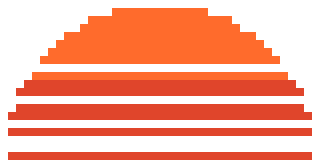

- **Construction:** a half-disc standing on a horizon, orange above and red below. Blank bands cut across it, closer together toward the horizon. Counted up from the horizon, the bands are rows 1, 2, 4, 7, 11, 16, the gap growing by one each time (`sunGaps`).
- **Placement:** it always rises from the bottom edge, at the left: the bottom-left corner of a screen, of a layout, or of a patch's sky. Its center can sit on the corner or a little in.
- **One per piece.** It's the focal point. Two would compete.
- **On patches** it becomes a planet or sun at the lower left, drawn smooth: a planet with an orange rim (the monitor patch), or an orange sun over a planet's limb (the round patch).

The sun appears on the sunrise screen, the desktop icon, the desk set, both patches, the wallpaper and the social card. `sun()` draws it in any box.

## Playing with the shape

The monitor can change shape and still be the mark, as long as its parts stay recognizable: the outline, the cream case, the dark screen, the light at the bottom left, the foot.

- **Stretch** the frame wider or taller, keeping its parts' sizes: the widescreen and sunrise screen lockups. Never scale it unevenly; build it at the new proportions with `frame()`.
- **Tilt** it forward, at the theme's one angle of −12°: Racing Stripes.
- **Turn** it three-quarters, in the round: Isometric.
- **Borrow its outline** for something that isn't a computer: the monitor patch is cut to the frame's shape.
- **Put it somewhere:** on a tile (the app icon), in a badge's well, on a patch, on a desktop.

## Themes

The base, and four themes on it. The major themes are fully worked out and can carry a whole piece; the minor ones are smaller gestures. None of them is a fence: "Making a new theme" says how to add more.

### Major: Isometric

The monitor, and the whole desk set, in the round: 2:1 pixel isometric like a 90s icon, cream plastic lit from the upper left.

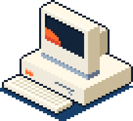

- **Pieces:**
  - `isoMonitorRows()`, `deskSetRows()` and `drawIso()`.
  - Assets in [`assets/isometric/`](assets/isometric/).
  - `isoScene()` and `box()` for drawing new objects in the same style.
- **Grounds:** Desktop Blue or Paper, with a flat floor shadow in Deep Blue (on blue) or the cream ramp (on paper). No platforms or tiles under objects.
- **Type:** the pixel faces. On blue, the name is cream with its ink shadow.
- **The light:** the sunrise on the screen, the power LED at the case's bottom left.
- **Example:** [`examples/iso-hero.mjs`](examples/iso-hero.mjs).

### Major: Mission Patch

Embroidered patches: the brand as something a crew would wear.

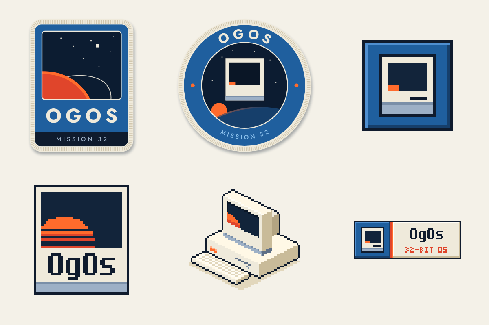

- **Pieces:** `monitorPatch()`, `roundPatch()` and `roundPatchIcon()`; assets in [`assets/patch/`](assets/patch/).
- **Construction:**
  - A cream merrowed edge, a Desktop Blue field and a Space sky.
  - One light at the lower left: a planet or the sun.
  - A few cream stars, one orbit at most.
  - Flat thread colors and one line weight.
- **Type:** Jost, in capitals: the name in Bold, tracked wide; a mission line in Medium. MISSION 32 is the canonical line, and a release or event can have its own ([`examples/release-patch.mjs`](examples/release-patch.mjs)).
- **Grounds:** the masters are flat, for printing and embroidery. To show a patch as an object, put it on Charcoal or Paper with a soft shadow (`shadow: true`).
- **Avoid:** cartoon stars, twill textures, orbits through the screen, more than one light.

### Minor: Web Badge

The 88 × 31 button of the early web.

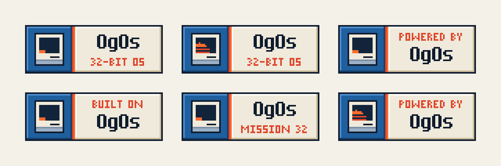

- **Pieces:** `badgeRows()` and `badge()`, or `node tools/make.mjs badge ...`; assets in [`assets/badge/`](assets/badge/).
- **Construction:** the monitor on a beveled blue well, a red and an orange stripe, and a cream panel with the name in OgOs Label and a line in OgOs Micro, in red. The line goes above or below the name.
- **Size:** use badges at 1x, where they're crisp, or at whole multiples. Text that doesn't fit the panel is refused.

### Minor: Racing Stripes

The monitor leaning into speed, trailing four stripes in cream, orange, red and sky that break into squares.

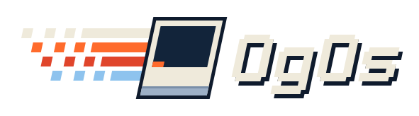

- **Pieces:** `racing()`, `stripes()` and `leanAbout()`; assets in [`assets/stripes/`](assets/stripes/).
- **Rules:**
  - One angle, −12°.
  - The name in OgOs Display, cream with its ink shadow, leaning with the monitor.
  - Every stripe ends in the same run of squares. The gaps widen evenly, and none are missing.
  - On Desktop Blue.

### Making a new theme

The themes above are examples of what the identity can do, not a list of what it may. A new theme, or a one-off riff, is on brand if it keeps **the anchors**:

1. **The monitor,** or a shape that's clearly a homage to it, as the monitor patch is.
2. **The palette,** with Desktop Blue present, or a reason it isn't (patches are shown on Charcoal).
3. **The light at the bottom left:** the LED, the sun, or a planet.
4. **The kit's type:** the pixel faces, or Jost capitals for anything patch-like.

Everything else can move: the material (pixels, thread, enamel, print), the projection (front, tilted, isometric), the context (a badge, a patch, a desktop, a boot screen, a box), the scale and the density.

To add one:
1. Make two or three options as compositions (see README, "Making something new").
2. Check them against the anchors and the checklist below.
3. Show them to the operator.
4. Record the decision in FEEDBACK.md.
5. If it's a keeper, add it here as a minor theme, with its pieces in `tools/lib/` and its assets in `tools/catalog.mjs`.

Ideas nobody has tried yet, as starting points: a floppy-disk label, an enamel pin, a BIOS-style boot screen, a blueprint of the monitor, cross-stitch.

## Do and don't

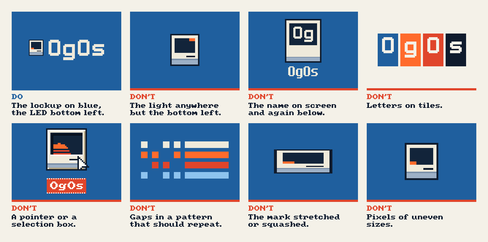

**Don't:**
- **Move the light** anywhere but the bottom left.
- **Spell the name on the screen** and again below it. The name appears once.
- **Put letters on colored tiles** (#103).
- **Add a pointer, a dotted focus ring or a selection box** (#108). The icon stands on its own.
- **Leave gaps in a pattern that should repeat,** like a trail with squares missing (#110).
- **Stretch or squash** the mark. Rebuild it at the new proportions instead.
- **Scale pixel art by fractions.**
- **Use retired typefaces** (Saira, Archivo) or bring in new ones.
- **Put the monitor on a platform** in isometric scenes (#104).
- **Use the monitor-with-an-O icon** (#102's icon).
- **Make patches childish:** cartoon stars, twill, bright outlines (#52).
- **Copy another OS's logo,** even loosely (#1 was "too obviously a rip of the Win95 logo").

## Checklist

Use this to judge any piece, your own or someone else's. The `ogos-brand-review` skill walks through it.

1. **The mark:** is the monitor there, intact, or clearly homaged? Is it drawn from a master or with `frame()`, not stretched?
2. **The light:** is it at the bottom left, and is there only one sun?
3. **The name:** does it appear once, spelled OgOs (or OGOS in a patch, or in Micro)?
4. **Color:** is every color in the palette (`tools/check.mjs`)? Is Desktop Blue, or the theme's ground, the main ground? Are orange and red only light?
5. **Type:** is it from the kit, and is the text outlined, not live? Is Jost used only in patches?
6. **The grid:** is the pixel art at whole-number scales, on one base pixel?
7. **The theme:** is it one theme, or the base, with no theme's details mixed into another's?
8. **The don'ts:** is the piece clear of everything on the list above?
9. **Legibility:** does everything read at the size it'll be used? Is the small master used below the minimum sizes?
10. **Clear space:** is there room around the lockup, with nothing crowding the mark?

## In the OS itself

OgOs draws in RGB332 (3 bits red, 3 green, 2 blue), so the palette can't be shown exactly on its own screen. The nearest values, rounding each channel:

| Color | Hex | RGB332 | Shows as |
|---|---|---|---|
| Desktop Blue | `#1F5F9E` | `0x2E` | `#246DAA` |
| Ink | `#0F1B2D` | `0x05` | `#002455` |
| Screen | `#12243A` | `0x05` | `#002455`, the same as Ink |
| Case Cream | `#EFEADB` | `0xFB` | `#FFDBFF`, pinkish: use `0xFF`, white, instead |
| Paper | `#F4F1E8` | `0xFF` | `#FFFFFF` |
| Sunrise Orange | `#FF6B2C` | `0xED` | `#FF6D55` |
| Signal Red | `#E0452B` | `0xC9` | `#DB4955` |
| Deep Blue | `#163F6B` | `0x29` | `#244955` |
| Light Blue | `#4F8FD0` | `0x52` | `#4992AA` |
| Steel | `#9DB0C6` | `0x96` | `#92B6AA` |

These are computed, not tried on screen. Check them in QEMU before building on them.

## Open questions

These are decisions the operator hasn't made yet. Until they're made, the kit does as noted.

- **A face for long text,** for docs and website body copy. Until one is chosen, use the reader's system UI font.
- **A tagline.** The examples say "A 32-bit hobby OS", which is a description, not a slogan.
- **The OS's own colors:** a reviewed RGB332 mapping, for the wallpaper, boot screen and icons inside OgOs (see above).
- **Producing patches:** thread colors for real embroidery.
